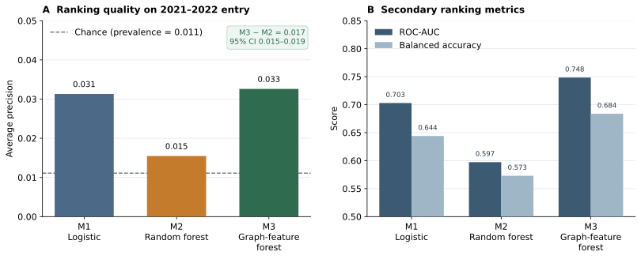

# Temporal Knowledge-Graph Features for Firm-Specific Technology Opportunity Prediction
## An Explainable Decision-Support Benchmark for Digital Innovation

**Article type:** Short communication  
**Target journal:** *Knowledge-Based Systems*

## Abstract
Firms deciding which technology domains to explore can observe only a fragment of the relevant knowledge: their own patent history. Relations among firms and Cooperative Patent Classification (CPC) subclasses make additional structure explicit, but graph-based opportunity models are easy to overfit to the future. This short communication tests a narrower claim. Using USPTO PatentsView grant records for 10,878 organization assignees (2010–2023), we build a time-indexed firm–technology graph and ask whether three inspectable relational features improve next-year entry prediction after leakage is removed. Logistic regression and a random forest trained on firm and class activity are compared with the same forest after those graph features are added. Candidates, features, and thresholds are frozen before a 2021–2022 holdout (455,458 pairs; 1.11% positives). The graph-feature forest raises average precision relative to the same-learner forest (ΔAP = 0.017; firm-cluster 95% interval 0.015–0.019). Logistic regression remains a competitive ranking baseline, and absolute average precision stays low. Relational knowledge therefore adds incremental, auditable signal for this task; it does not by itself produce a deployable opportunity engine.

**Keywords:** knowledge-based systems; knowledge graph; technology opportunity discovery; patent analytics; temporal validation; explainable AI; digital innovation.

## 1. Introduction
A firm that already patents in a few CPC subclasses still has to decide which adjacent classes are worth entering next. That decision is a knowledge problem: useful evidence is distributed across the firm’s portfolio, the portfolios of technological neighbours, and the historical popularity of the candidate class. A knowledge-based system can represent those relations and turn them into a ranked list. It should also say when the representation does not earn its place.

The technology-opportunity discovery (TOD) literature already uses graphs for this purpose. Lee et al. (2021) predict firm-specific opportunities from F-term co-occurrence networks. Park and Geum (2022) apply graph-convolutional link prediction to technology convergence and then map candidates to a firm. Choi et al. (2023) embed assignees, inventors, patents, and technology areas in a heterogeneous ecology. Seol et al. (2023) extract association rules from portfolio graphs. Later studies add competitor-aware rules, dual citation-network recommendation, and heterogeneous graph neural networks (Wu & Ji, 2023; Liu et al., 2025; Zhao et al., 2025; Wu et al., 2026). Knowledge-graph recommenders similarly rank patents for acquisition or reading (Chen & Deng, 2023; He et al., 2026). Kinne and Lenz (2021) show that large-scale digital traces can complement traditional innovation indicators. The existence of a graph, however, is not a novelty claim, and graph convolution is not automatically interpretable (Rajabi & Etminani, 2024).

The operational failure mode is temporal leakage. If candidate classes, co-occurrence edges, or train–test splits are built with future grants, a retrospective model can look accurate without being usable at the moment a firm would actually request a recommendation. This paper therefore does not introduce another graph neural network. It specifies a leakage-controlled, many-firm benchmark and measures whether a small, inspectable relational feature block improves out-of-time CPC-entry ranking on public patent data.

## 2. Research gap and hypotheses
Retrieved TOD studies typically validate one firm, one industry case, or a link-prediction score. They rarely report a many-assignee, embargoed chronological comparison of inspectable graph features against strong tabular baselines on the same firm–class pairs. The search behind that reading is documented in `data/LITERATURE_SEARCH.md` (Crossref, publisher records, and RePEc, 2018–2026). It is not a Scopus/Web of Science systematic review.

The scoped gap is therefore a **compact firm–technology entry benchmark in which candidate construction, feature timestamps, and incremental graph-feature value are all auditable**. The research question is: do temporally available knowledge-graph features improve out-of-time prediction of a firm’s first grant in a previously unadopted CPC subclass, relative to conventional firm- and class-level predictors?

- **H1.** The graph-feature model has higher average precision than the strongest tabular baseline on the held-out period.
- **H2.** Removing the graph-feature block reduces average precision when the learner is held constant (M3 versus M2).
- **H3.** Any gain is stable across more than one chronological cutoff.

H2 is the pre-specified primary contrast. H3 is not tested in this short communication: only the protocol’s single split is reported.

## 3. Data and knowledge representation
The source is the USPTO PatentsView granted-patent metadata dump through 31 December 2024 (USPTO, 2025). Later Open Data Portal files require authenticated access (USPTO, 2026). Tables `g_patent`, `g_assignee_disambiguated`, and `g_cpc_current` were downloaded on 23 October 2026 and joined on `patent_id`. `firm_id` is the disambiguated organization `assignee_id`; individuals are dropped. `year` is the grant year. CPC codes are four-character subclasses. Former-USPC indexing codes `Y10*` are excluded. Joint assignees create one row per organization. Firms must have at least eight grant years, eight subclasses, twenty firm–year–CPC rows, and at least one G or H subclass in 2010–2023. The extract contains 1,453,416 unique firm–year–CPC rows and 10,878 firms. Hashes and filters are in `data/processed/firm_year_cpc.provenance.json`.

The outcome is **patent-observed class entry**, not commercial innovation. For firm *f*, candidate class *c*, and prediction year *t*, the label is one if *c* is absent from *f*’s history through *t* and appears in *t*+1.

Let \(G_t=(F,C,E_t)\), where *C* is the 30 most frequent subclasses in 2010–2012 and \(E_t\) contains firm–class edges observed no later than *t*. Class–class relations are induced from co-occurrence in portfolios dated ≤ *t*. Tabular features are portfolio size, historical activity, class prevalence, and recent class growth. Graph features are common-neighbour co-occurrence with the firm’s current portfolio, peer-adoption among overlapping firms, and candidate-class degree. No graph neural network is used.

## 4. Experimental design
Three models are trained on identical pairs: **M1** logistic regression on tabular features; **M2** a class-weighted random forest on the same features; **M3** the same forest with the graph-feature block added. The primary comparison is M3 versus M2 because it isolates the knowledge layer. M1 is the linear reference.

Prediction years 2013–2019 form the training window (1,540,698 pairs). 2020 is embargoed. 2021–2022 is the test window; labels are entry in 2022–2023. Features at *t* use only records ≤ *t*. The candidate universe is never rebuilt on the test years. The decision threshold for balanced accuracy is chosen on 2019 only. The primary metric is average precision, reported beside prevalence. ROC-AUC, balanced accuracy, and Brier score are secondary. Uncertainty for M3 − M2 average precision is a 1,000-replicate paired bootstrap that resamples firms as clusters.

**Figure 1** is the architecture actually implemented: PatentsView tables, the time-indexed graph, the two feature blocks, the three models, and the 2010–2022 split.

**Figure 1.** Time-stamped USPTO grant relations become a firm–technology graph. Features, candidates, and thresholds are frozen before the 2021–2022 holdout.

## 5. Results
Table 1 states the evaluation sample. Table 2 and Figure 2 report the measured holdout. Demo-mode numbers are not used.

**Table 1. Evaluation sample from the PatentsView extract**

| Item | Value |
|---|---|
| Source | USPTO PatentsView grants through 31 Dec 2024 (Zenodo) |
| Firms after inclusion rules | 10,878 organization assignees |
| Unique firm–year–CPC rows | 1,453,416 (2010–2023) |
| Burn-in / candidate universe | 2010–2012; 30 CPC subclasses |
| Training prediction years | 2013–2019; 1,540,698 pairs |
| Embargo year | 2020 |
| Test prediction years | 2021–2022; 455,458 pairs; 10,411 firms |
| Test-positive prevalence | 1.11% (about 5,057 entries) |

**Table 2. Held-out performance, 2021–2022 firm–candidate pairs**

| Model | Average precision | ROC-AUC | Balanced accuracy | Brier score |
|---|---:|---:|---:|---:|
| M1 logistic regression | 0.0313 | 0.703 | 0.644 | 0.156 |
| M2 random forest | 0.0155 | 0.597 | 0.573 | 0.046 |
| M3 graph-feature forest | 0.0326 | 0.748 | 0.684 | 0.025 |
| M3 − M2 (firm-cluster 95% CI) | 0.0172 (0.0155, 0.0191) | — | — | — |

Chance-level average precision equals prevalence (0.011). All three models beat chance. M3 is best on every reported metric. The pre-specified same-learner contrast supports **H2**: dropping the graph features reduces average precision, and the cluster interval excludes zero.

**H1 is not established.** The strongest tabular model on average precision is M1, not M2. M3’s advantage over logistic regression is 0.0013 and has no cluster interval. The forest without graph features is a weak ranking baseline; the linear model is not. **H3 is untested.**

**Figure 2.** Panel A shows average precision against the 1.11% base rate and the firm-cluster interval for M3 − M2. Panel B shows ROC-AUC and balanced accuracy on the same pairs. Average precision is plotted on its own scale so the rare-event metric is readable.

Brier scores add a calibration caveat. Class-weighted logistic regression ranks well and is poorly calibrated (Brier 0.156). Both forests are better as probabilities, and M3 is best (0.025). A decision-support list can use M3 scores for ranking; it should not treat M1 probabilities as frequencies.

## 6. Discussion
The measured contribution is incremental and specific. On more than ten thousand USPTO organization assignees, three time-valid graph features added average-precision value that a random forest did not extract from activity and popularity alone. That is the knowledge-based-systems claim: an explicit relational representation changed out-of-time ranking, and the change can be inspected feature by feature.

The same numbers block a stronger claim. Logistic regression almost matches M3 on average precision, so “graph model beats tabular model” is false if the tabular model is linear. Absolute AP of 0.033 means most highly ranked firm–class pairs still do not enter next year. The system can order a review list. It cannot authorize entry, and it cannot discover classes that were absent from 2010–2012.

Relative to the retrieved TOD literature, the contribution is not a new GNN. It is a many-firm, leakage-controlled test of whether a small knowledge layer earns inclusion. That is a narrower scope than most graph-TOD papers, and it is the scope this short communication can defend.

## 7. Limitations and reproducibility
Patent class entry is not entrepreneurial success. Grant year is a delayed proxy for the moment of invention. Assignee disambiguation is imperfect. The G/H activity filter and the fixed 30-class universe restrict external validity. A second cutoff, an M3 − M1 cluster interval, application-date timing, and CPC-revision concordance remain to be run.

The repository archives the Zenodo DOI, download date, preparation script, file hash, seed, split, and outputs. The `--demo` switch is a software smoke test and is not cited above.

## 8. Conclusion
Temporally valid firm–technology graph features improve next-year CPC-entry ranking relative to the same random forest without those features, on a public PatentsView extract, with a firm-cluster interval that excludes no gain. Logistic regression remains a strong baseline, and absolute precision remains low. For *Knowledge-Based Systems*, the result justifies keeping an inspectable knowledge layer in this pipeline—and only that.

## Data and code availability
**Data:** USPTO PatentsView granted-patent metadata through 31 December 2024, DOI 10.5281/zenodo.15058362, downloaded 23 October 2026. Normalized file: `data/processed/firm_year_cpc.csv.gz`.  
**Code:** https://github.com/eeshwar-research/research-paper (`src/prepare_patentsview.py`, `src/experiment.py`).  
**Outputs:** `outputs/metrics.csv`, `outputs/paired_bootstrap.csv`, `figures/figure1_architecture.svg`, `figures/figure2_results.svg`.

## Declarations
**Funding, competing interests, and author contributions:** to be completed by the author.  
**Use of AI-assisted tools:** disclose in accordance with the journal’s policy. The author must verify the manuscript, code, citations, and results.

## References
1. Chen, H., & Deng, W. (2023). Interpretable patent recommendation with knowledge graph and deep learning. *Scientific Reports, 13*, 2586. https://doi.org/10.1038/s41598-023-28766-y
2. Choi, J., Lee, C., & Yoon, J. (2023). Exploring a technology ecology for technology opportunity discovery: A link prediction approach using heterogeneous knowledge graphs. *Technological Forecasting and Social Change, 186*, 122161. https://doi.org/10.1016/j.techfore.2022.122161
3. He, S., Guan, X., & Ran, C. (2026). A personalized patent recommendation system using knowledge maps to foster enterprise innovation. *Scientific Reports*. https://doi.org/10.1038/s41598-026-52263-7
4. Kinne, J., & Lenz, D. (2021). Predicting innovative firms using web mining and deep learning. *PLOS ONE, 16*(4), e0249071. https://doi.org/10.1371/journal.pone.0249071
5. Lee, J., Ko, N., Yoon, J., & Son, C. (2021). An approach for discovering firm-specific technology opportunities: Application of link prediction to F-term networks. *Technological Forecasting and Social Change, 168*, 120746. https://doi.org/10.1016/j.techfore.2021.120746
6. Liu, Z., Wang, X., & Feng, J. (2025). Generating firm-centric technology opportunities from patent recommendation: A dual link prediction perspective. *Technology Analysis & Strategic Management, 38*(7), 925–942. https://doi.org/10.1080/09537325.2025.2492229
7. Park, M., & Geum, Y. (2022). Two-stage technology opportunity discovery for firm-level decision making: GCN-based link-prediction approach. *Technological Forecasting and Social Change, 183*, 121934. https://doi.org/10.1016/j.techfore.2022.121934
8. Rajabi, E., & Etminani, K. (2024). Knowledge-graph-based explainable AI: A systematic review. *Journal of Information Science, 50*(4), 1019–1029. https://doi.org/10.1177/01655515221112844
9. Seol, Y., Lee, S., Kim, C., Yoon, J., & Choi, J. (2023). Towards firm-specific technology opportunities: A rule-based machine learning approach to technology portfolio analysis. *Journal of Informetrics, 17*(4), 101464. https://doi.org/10.1016/j.joi.2023.101464
10. United States Patent and Trademark Office. (2025). *Final release of PatentsView metadata, pre-grant and granted (12/31/2024)* [Data set]. Zenodo. https://doi.org/10.5281/zenodo.15058362
11. United States Patent and Trademark Office. (2026). *PatentsView: Research-ready patent data and data downloads*. https://www.uspto.gov/ip-policy/economic-research/patentsview
12. Wu, Y., & Ji, Y. (2023). Identifying firm-specific technology opportunities from the perspective of competitors by using association rule mining. *Journal of Informetrics, 17*(2), 101398. https://doi.org/10.1016/j.joi.2023.101398
13. Wu, Y., Lin, Z., Ji, Y., & Gu, F. (2026). Identifying firm-specific technology opportunities: Heterogeneous graph neural network-based link prediction. *Technovation, 151*, 103405. https://doi.org/10.1016/j.technovation.2025.103405
14. Zhao, R., Wei, W., & Zhu, Z. (2025). Discovering firm technology opportunities by machine learning prediction method based on firm's technology portfolio. *Technological Forecasting and Social Change, 221*, 124305. https://doi.org/10.1016/j.techfore.2025.124305
