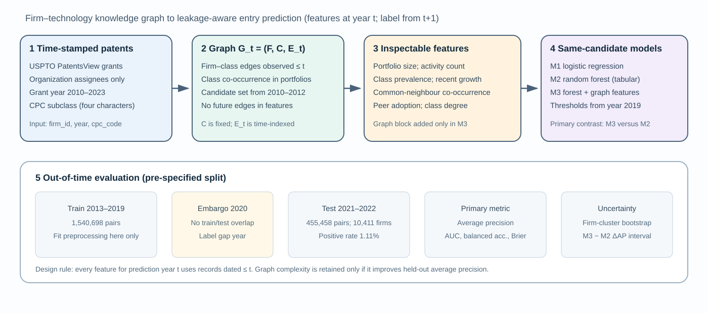
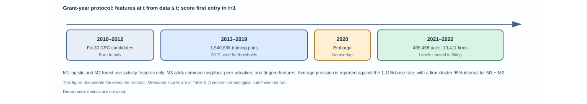

# Temporal Knowledge-Graph Features for Firm-Specific Technology Opportunity Prediction
## An Explainable Decision-Support Benchmark for Digital Innovation

**Article type:** Short communication — full working manuscript  
**Target journal:** *Knowledge-Based Systems*  
**Evidence status:** Methods and analysis plan are specified; real-data results are not yet available. No performance values are fabricated.  
**Reference-paper use:** The author's accepted short communication is used as a structural reference for explicit mechanisms, credible baselines, component ablation, uncertainty reporting, and limitations. Its domain-specific content and results are not reused.

## Abstract
Firms pursuing digital innovation must decide which technology domains to explore beyond their existing capabilities. Patent portfolios provide observable traces of technological activity, while relations between firms and technology classes provide a structured basis for knowledge-aware decision support. However, graph-based opportunity discovery is vulnerable to a practical evaluation problem: a model can appear effective when future technology relations leak into features, candidate sets, or random train–test splits. This short communication specifies a temporally constrained benchmark for predicting whether a firm will enter a previously unadopted technology class in the following year. A firm–technology knowledge graph is constructed from public patent records. The proposed model augments firm and technology activity features with graph-derived common-neighbour, technology co-occurrence, and historical peer signals. It is compared with logistic regression and random-forest baselines on identical firm–technology candidates using chronological evaluation, an embargo between training labels and the test period, paired bootstrap intervals, and imbalance-aware metrics. The contribution is deliberately bounded: the study tests whether transparent relational features add out-of-time predictive value, rather than assuming that graph complexity is beneficial. The repository provides a reproducible pipeline and two publication-oriented figures. Because no real-data run has yet been completed, this manuscript reports no empirical superiority claim; measured findings must be inserted only after the documented experiment is executed and audited.

**Keywords:** knowledge-based systems; knowledge graph; technology opportunity discovery; firm innovation; patent analytics; temporal validation; explainable AI; digital innovation; decision support.

## 1. Introduction
Digital innovation often requires firms to move beyond the technology domains in which they already operate. A firm may have relevant capabilities for entering an adjacent domain, yet its internal patent history alone does not reveal all useful connections. Technology classes co-occur in patent portfolios, firms share technological neighbours, and adoption patterns evolve over time. A knowledge representation can make these relationships explicit and support a prediction system whose recommendations are grounded in identifiable evidence.

Research has already explored graph convolution for technology convergence and firm-level opportunity discovery. Park and Geum (2022), for example, use graph-based link prediction to anticipate technology convergence and then assess opportunities at the firm level. Work on predicting innovative firms also demonstrates that large-scale digital traces can complement traditional innovation indicators (Kinne & Lenz, 2021). More recent patent-recommendation and heterogeneous-graph studies reinforce that the general idea of graph-based innovation prediction is not, by itself, a sufficient novelty claim. The relevant question is narrower and more falsifiable: when candidate technologies, feature timestamps, and evaluation cutoffs are controlled, do compact, interpretable graph features add predictive value over strong tabular baselines?

This question matters for *Knowledge-Based Systems* because an intelligent decision-support system should make its knowledge representation explicit, evaluate the contribution of that representation, and disclose when the knowledge layer does not improve decisions. Knowledge graphs can support explainability, but the existence of a graph does not automatically make a model interpretable or reliable (Rajabi & Etminani, 2024). Temporal leakage is especially consequential in innovation forecasting: future patent classifications, future firm–technology links, or labels that would not yet have been observable can make a retrospective model look stronger than a deployable one.

This paper therefore proposes a leakage-aware, firm-specific technology-entry benchmark. It does not claim that patenting captures all innovation, that prediction is causal, or that the approach is the first graph-based technology-opportunity method. Its narrower contribution is a reproducible experimental design that tests the incremental value of auditable relational features under a common temporal protocol.

## 2. Research gap and research question
### 2.1 What is known
Three strands are directly relevant. First, graph-based technology-opportunity discovery predicts relationships among technology domains and maps the results to firm-level decisions (Park & Geum, 2022). Second, web and patent traces have been used to identify innovative firms at scale (Kinne & Lenz, 2021). Third, knowledge-graph explainability research distinguishes several mechanisms—such as feature extraction, relationship extraction, graph construction, and reasoning—rather than treating “knowledge graph” as a single technique (Rajabi & Etminani, 2024). Public patent infrastructure, including PatentsView, provides disambiguated organization and technology data that can support reproducible analyses, subject to documented coverage and matching limitations (USPTO, 2026).

### 2.2 Specific gap
The literature does not justify a blanket claim that graph models outperform conventional methods. A more useful gap for this short communication is the need for a **compact, firm–technology entry benchmark in which candidate construction, graph features, temporal availability, and incremental model value are all auditable in one protocol**. This is a scoped synthesis of the literature reviewed here, not a claim that no prior study has ever used temporal validation or interpretable graph features. A systematic review of a larger corpus would be required to establish an exhaustive novelty claim.

### 2.3 Research question and hypotheses
**RQ:** Do temporally available knowledge-graph features improve out-of-time prediction of a firm's entry into a previously unadopted technology class, compared with conventional firm- and technology-level predictors?

- **H1 (incremental value):** The graph-feature model achieves higher average precision than the strongest tabular baseline on the held-out future period.
- **H2 (relational contribution):** Removing graph-derived features reduces performance relative to the full model.
- **H3 (temporal robustness):** Any observed improvement is directionally stable across additional chronological cutoffs, rather than being confined to one test window.

These are hypotheses to test, not findings. H1 or H2 may be rejected. A null result is publishable only if data quality, sample size, and evaluation power are adequately described.

## 3. Data and operational definitions
### 3.1 Data source and scope
The proposed source is the USPTO's PatentsView data, now distributed through the USPTO Open Data Portal. PatentsView provides structured patent records and disambiguated assignee/organization and technology information, with documentation of data processing and updates. The official source reports coverage of granted patents and pre-grant publications through 31 December 2025 in its current release notes (USPTO, 2026). The data are publicly discoverable, but a researcher must record the exact downloaded release, file names, download date, and license/terms at execution time.

The analysis requires a normalized firm–year–technology table with one row per unique firm–year–CPC subclass relation and fields `firm_id`, `year`, and `cpc_code`, derived from the patent, assignee, and CPC tables. This is an input contract, not a claim that a processed dataset has already been downloaded or cleaned. The preparation log must record the exact PatentsView tables and join keys used, how joint assignees are treated, how missing or ambiguous firm identifiers are handled, and how CPC codes are harmonized across years. A patent assigned to multiple firms may create multiple firm–technology relations; this choice must be disclosed and checked in sensitivity analysis.

Patent activity is an imperfect proxy for innovation. It undercounts non-patented, service, organizational, and process innovations; differs by sector and firm size; and reflects patenting strategy as well as inventive output. The paper consequently interprets the outcome as **technology-class entry observed in patent data**, not as a comprehensive measure of entrepreneurship or innovation.

### 3.2 Unit of analysis and outcome
The unit is a firm–candidate-technology–prediction-year triple. For firm (f), candidate technology (c), and prediction year (t), the binary target is one when the firm has no observed patent in class (c) by the end of year (t) and first appears in that class in year (t+1). Otherwise, among eligible candidates, the target is zero. Firms must have patent history before the prediction year. The candidate technology universe is fixed using a pre-specified burn-in period and retained throughout evaluation; it is not selected using the future test period. This design estimates entry into technology classes already visible in the initial data window and does not claim to predict entirely unseen classes.

### 3.3 Knowledge graph
Let (G_t=(F,C,E_t)), where (F) is the set of firms, (C) is the fixed set of candidate CPC classes, and (E_t) contains firm–technology edges observed no later than year (t). Technology–technology relations are induced from co-occurrence in firm portfolios observed by (t). The graph is time-indexed: future edges are not used to calculate a prediction made at (t).

Graph features are intentionally simple and inspectable: (i) common-neighbour/co-occurrence strength between a firm's existing portfolio and a candidate class; (ii) candidate-class prevalence and recent growth calculated from information available by (t); and (iii) a historical peer-adoption signal among firms with overlapping technology portfolios. Conventional features describe firm portfolio size and historical firm–technology activity volume, as well as candidate-class popularity. The full model adds the relational features to the same conventional predictors used by the tabular baseline. No graph neural network is claimed or implemented in this compact benchmark.

## 4. Experimental design
### 4.1 Models and controlled comparison
Three models are compared on the same candidate pairs:

1. **M1 — Logistic regression:** a transparent linear baseline.
2. **M2 — Random forest:** a nonlinear tabular baseline.
3. **M3 — Graph-feature random forest:** the same random-forest learner augmented with the pre-specified graph-derived features.

The primary comparison is M3 against M2 because it isolates the incremental value of the relational feature block while holding the learning algorithm constant. M1 provides a simpler reference point. Hyperparameters, class weighting, candidate universe, and feature availability must be fixed before the final test is evaluated. If tuning is performed, it must occur only within the training period, preferably using rolling-origin validation.

### 4.2 Temporal split and leakage controls
Rows are ordered by prediction year. Training examples must have outcome years that end before the test prediction window begins; an embargo year is excluded between the final training prediction year and the first test prediction year. Every feature for a firm–candidate pair is calculated from records available by that pair's prediction cutoff. The candidate universe is fixed from the initial burn-in period. Preprocessing is fitted only on training rows. Test labels are used only for final scoring and uncertainty estimation. The final study should repeat the analysis at more than one chronological cutoff if the number of years permits.

This protocol addresses common forms of leakage but does not by itself guarantee validity. The implementation must be audited for firm identity duplication, patent publication/grant timing, CPC revision effects, joint assignees, and any future information embedded in the source release. For a real deployment claim, the prediction date must be defined precisely—for example, year-end—and all features must be available at that date.

### 4.3 Metrics and statistical analysis
Technology-entry prediction is imbalanced: most firm–candidate pairs are expected not to become positive in any one year. The primary metric is average precision, reported with the test positive prevalence. ROC-AUC is secondary because it can appear favourable under severe imbalance. Balanced accuracy is reported at a threshold selected only on training data; Brier score is reported for probability quality. Report the number of firms, candidate classes, firm–candidate–year rows, positives, and prevalence for each split.

For the primary M3–M2 comparison, use paired bootstrap resampling of held-out firm–candidate pairs and report a 95% interval for the metric difference. Because repeated rows from the same firm are dependent, the preferred final analysis resamples firms as clusters, preserving all their held-out rows together. If a cluster bootstrap is computationally infeasible, this limitation must be reported and row-level intervals treated as provisional. H1 is supported only if the pre-specified primary comparison is positive and uncertainty is reported; a point estimate alone is insufficient. Multiple time cutoffs and feature ablations are robustness analyses, not opportunities to select the most favourable result.

## 5. Results reporting plan
No empirical results are reported in this manuscript version because the real PatentsView extract has not yet been processed and the experiment has not been run on it. Table 1 defines the controlled comparison. Table 2 specifies the metrics and inference plan. The result chart generated by the code is intended to display observed performance after execution; it must not be populated with synthetic or illustrative values and presented as real evidence.

**Table 1. Model comparison and the causal question each comparison addresses**

| Model | Input feature blocks | Comparison purpose |
|---|---|---|
| M1: Logistic regression | Firm history + candidate-class activity | Establishes a transparent baseline |
| M2: Random forest | Same conventional features as M1 | Tests nonlinear tabular prediction |
| M3: Graph-feature random forest | M2 features + temporal relational features | Primary test of incremental graph-feature value |

**Table 2. Pre-specified evaluation and robustness protocol**

| Dimension | Required report | Interpretation safeguard |
|---|---|---|
| Primary discrimination | Average precision and positive prevalence | Prevalence must accompany AP |
| Secondary ranking | ROC-AUC | Do not use alone for imbalanced data |
| Thresholded prediction | Balanced accuracy; threshold chosen on training data | No test-set threshold tuning |
| Probability quality | Brier score and calibration assessment | Ranking is not calibration |
| Incremental value | Paired, preferably firm-clustered, bootstrap interval for M3–M2 | Same held-out observations; uncertainty shown |
| Temporal robustness | At least two cutoffs where feasible; report every cutoff | Avoid selecting only the best period |
| Component contribution | Ablation removing graph features | Distinguishes relational value from model complexity |
| Data validity | Firm count, class count, rows, positives, prevalence, exclusions | Makes selection and imbalance visible |

**Figure 1. Knowledge-graph feature pipeline and decision-support architecture.** The figure shows how time-stamped patent relations become firm–technology graph features, which are compared with conventional predictors under one shared evaluation protocol.

**Figure 2. Leakage-aware temporal evaluation protocol.** The figure distinguishes the historical burn-in and candidate-universe definition, training labels, embargo, and later test outcomes. It is a protocol diagram, not a measured performance plot.

After execution, this section must be completed with the actual output from the versioned dataset: (a) descriptive sample statistics; (b) all three models' test metrics; (c) the M3–M2 confidence interval; (d) the results of each pre-specified temporal cutoff and ablation; and (e) calibration and subgroup findings. Do not infer or write that H1–H3 are supported before these outputs exist. If M3 does not improve on M2, report that result and investigate sparsity, data coverage, and drift rather than changing the test protocol post hoc.

## 6. Discussion
The intended contribution is a test of whether explicit relational knowledge adds useful predictive information for firm-specific technology-entry decisions. If the graph-feature model improves average precision consistently across temporal cutoffs and the firm-clustered interval excludes no improvement, the evidence would support the claim that the chosen relations contain incremental predictive signal for the observed patent-based task. Such a result would not establish that a firm should enter a technology, that graph features cause innovation, or that the model generalizes to all sectors or countries. Opportunity ranking is a decision-support input; strategic fit, cost, regulation, capabilities, and market demand remain outside this prediction target unless they are measured and included.

If performance does not improve, that is still informative. It would suggest that simple firm and technology histories capture most of the signal available in this dataset, or that the graph is too sparse or noisy to help. A transparent negative result is more useful than a complexity claim based on one favourable split. The primary model comparison and ablation are therefore central to the contribution.

For *Knowledge-Based Systems*, the value proposition is a compact, inspectable knowledge-based predictive system with a falsifiable evaluation—not the mere use of a graph. The paper's novelty is deliberately framed as an evaluation and feature-design contribution in a specific prediction setting. Before submission, the literature search must be extended systematically to Scopus/Web of Science and the final gap statement revised against the full retrieved corpus, including recent firm-specific technology-opportunity models.

## 7. Limitations, reproducibility, and responsible use
First, patent-based class entry is not equivalent to entrepreneurial success, commercial innovation, or digital transformation adoption. Second, assignee disambiguation and patent timing introduce measurement error. Third, the fixed candidate universe excludes technologies absent from the burn-in window; results do not cover open-ended discovery of entirely new classes. Fourth, graph features may favour firms in patent-intensive sectors. Fifth, temporal holdout performance can deteriorate under technology and market drift. Sixth, patent data are not a substitute for confidential strategy, and model scores should not be used to deny funding or make high-stakes decisions without independent validation and human review.

For reproducibility, archive the PatentsView release date, download links, raw-to-normalized data preparation script or exact documented steps, dataset hashes where permitted, inclusion criteria, random seed, package versions, commit hash, temporal cutoffs, and all model outputs. The repository's `--demo` mode is a software smoke test only; synthetic results must never be reported as empirical findings. Before submission, execute the pipeline on real data, run unit checks on temporal boundaries, and verify that no outcome-year or future graph edge enters features.

## 8. Conclusion
This short communication defines a reproducible test of whether temporal knowledge-graph features improve firm-specific technology-entry prediction over conventional models. Its strongest claim is conditional and testable: relational features deserve inclusion in innovation decision support only if they provide stable out-of-time value under a transparent protocol. The manuscript is not yet an empirical paper ready for submission because the real-data extraction, execution, and measured results remain outstanding. Completing those steps—not adding more terminology or visual decoration—is necessary to establish a credible contribution.

## Data and code availability
**Data:** Planned source is the public USPTO PatentsView / Open Data Portal. The exact release and normalized data file have not yet been downloaded or archived for this study.  
**Code:** [GitHub repository](https://github.com/eeshwar-research/research-paper).  
**Reproducibility status:** Pipeline implementation and manuscript protocol are provided; real-data empirical reproduction is pending.

## Declarations
**Funding:** To be completed by the author.  
**Competing interests:** To be completed by the author.  
**Author contributions:** To be completed by the author.  
**Use of AI-assisted tools:** Disclose the use of AI-assisted drafting and coding support in accordance with the target journal's current policy. The author must verify the manuscript, code, citations, and results and take responsibility for the final submission.

## References
1. Kinne, J., & Lenz, D. (2021). Predicting innovative firms using web mining and deep learning. *PLOS ONE, 16*(4), e0249071. https://doi.org/10.1371/journal.pone.0249071
2. Park, M., & Geum, Y. (2022). Two-stage technology opportunity discovery for firm-level decision making: GCN-based link-prediction approach. *Technological Forecasting and Social Change, 183*, 121934. https://doi.org/10.1016/j.techfore.2022.121934
3. Rajabi, E., & Etminani, K. (2024). Knowledge-graph-based explainable AI: A systematic review. *Journal of Information Science, 50*(4), 1019–1029. https://doi.org/10.1177/01655515221112844
4. United States Patent and Trademark Office (USPTO). (2026). *PatentsView: Research-ready patent data and data downloads*. https://www.uspto.gov/ip-policy/economic-research/patentsview
5. Maraut, S., Dernis, H., Webb, C., Spiezia, V., & Guellec, D. (2008). *The OECD REGPAT database: A presentation*. OECD Science, Technology and Industry Working Papers. https://doi.org/10.1787/241437144144
6. He, S., Guan, X., & Ran, C. (2026). A personalized patent recommendation system using knowledge maps to foster enterprise innovation. *Scientific Reports, 16*, 21266. https://doi.org/10.1038/s41598-026-52263-7
7. Wu, Y., Lin, Z., Ji, Y., & Gu, F. (2026). Identifying firm-specific technology opportunities: Heterogeneous graph neural network-based link prediction. *Technological Forecasting and Social Change, 151*. https://doi.org/10.1016/j.techfore.2025.123237

**Reference verification note:** Confirm the final bibliographic metadata for every citation against the publisher record before submission. The literature review should be expanded with a documented database search and inclusion criteria; this reference list is a focused starting set, not a systematic review.
