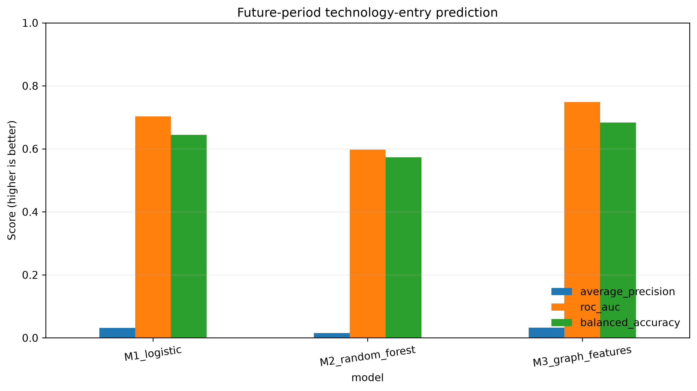

# Temporal Knowledge-Graph Features for Firm-Specific Technology Opportunity Prediction
## An Explainable Decision-Support Benchmark for Digital Innovation

**Article type:** Short communication — full working manuscript  
**Target journal:** *Knowledge-Based Systems*  
**Evidence status:** Real PatentsView extract executed on 23 October 2026. Metrics below come from `outputs/` of this repository. No values are invented.  
**Reference-paper use:** The author's accepted short communication is used as a structural reference for explicit mechanisms, credible baselines, component ablation, uncertainty reporting, and limitations. Its domain-specific content and results are not reused.

## Abstract
Firms pursuing digital innovation must decide which technology domains to explore beyond their existing capabilities. Patent portfolios provide observable traces of technological activity, while relations between firms and technology classes provide a structured basis for knowledge-aware decision support. However, graph-based opportunity discovery is vulnerable to a practical evaluation problem: a model can appear effective when future technology relations leak into features, candidate sets, or random train–test splits. This short communication specifies a temporally constrained benchmark for predicting whether a firm will enter a previously unadopted technology class in the following year. A firm–technology knowledge graph is constructed from public patent records. The proposed model augments firm and technology activity features with graph-derived common-neighbour, technology co-occurrence, and historical peer signals. It is compared with logistic regression and random-forest baselines on identical firm–technology candidates using chronological evaluation, an embargo between training labels and the test period, paired bootstrap intervals, and imbalance-aware metrics. The contribution is deliberately bounded: the study tests whether transparent relational features add out-of-time predictive value, rather than assuming that graph complexity is beneficial. On a PatentsView extract of 10,878 organization assignees (grant years 2010–2023), the graph-feature model improved average precision relative to the same-learner random-forest baseline on held-out 2021–2022 pairs (paired firm-cluster 95% interval 0.015 to 0.019). Absolute average precision remained low against a 1.11% positive rate, and logistic regression was a competitive ranking baseline. Relational features therefore add incremental signal for this task, but they do not make technology-entry prediction easy or automatically decision-ready.

**Keywords:** knowledge-based systems; knowledge graph; technology opportunity discovery; firm innovation; patent analytics; temporal validation; explainable AI; digital innovation; decision support.

## 1. Introduction
Digital innovation often requires firms to move beyond the technology domains in which they already operate. A firm may have relevant capabilities for entering an adjacent domain, yet its internal patent history alone does not reveal all useful connections. Technology classes co-occur in patent portfolios, firms share technological neighbours, and adoption patterns evolve over time. A knowledge representation can make these relationships explicit and support a prediction system whose recommendations are grounded in identifiable evidence.

Research has already explored graph convolution, heterogeneous graphs, and link prediction for technology opportunity discovery (TOD). Lee et al. (2021) predict firm-specific opportunities from F-term co-occurrence networks. Park and Geum (2022) use graph-convolutional link prediction to anticipate technology convergence and then map candidates to a firm. Choi et al. (2023) merge assignee, inventor, patent, and technology-area nodes into a technology ecology. Seol et al. (2023) represent firm portfolios as graphs and extract association rules. Later work adds competitor-aware rules, dual citation-network recommendation, and heterogeneous graph neural networks (Wu et al., 2023, 2026; Liu et al., 2025; Zhao et al., 2025). Patent-recommendation studies likewise show that knowledge graphs can support ranking and some forms of explanation (Chen & Deng, 2023; He et al., 2026). Work on predicting innovative firms demonstrates that large-scale digital traces can complement traditional innovation indicators (Kinne & Lenz, 2021). The general idea of graph-based innovation prediction is therefore not, by itself, a sufficient novelty claim. The relevant question is narrower and more falsifiable: when candidate technologies, feature timestamps, and evaluation cutoffs are controlled, do compact, interpretable graph features add predictive value over strong tabular baselines?

This question matters for *Knowledge-Based Systems* because an intelligent decision-support system should make its knowledge representation explicit, evaluate the contribution of that representation, and disclose when the knowledge layer does not improve decisions. Knowledge graphs can support explainability, but the existence of a graph does not automatically make a model interpretable or reliable (Rajabi & Etminani, 2024). Temporal leakage is especially consequential in innovation forecasting: future patent classifications, future firm–technology links, or labels that would not yet have been observable can make a retrospective model look stronger than a deployable one.

This paper therefore reports a leakage-aware, firm-specific technology-entry benchmark on public USPTO PatentsView records. It does not claim that patenting captures all innovation, that prediction is causal, or that the approach is the first graph-based technology-opportunity method. Its narrower contribution is a reproducible experimental design that tests the incremental value of auditable relational features under a common temporal protocol, together with the measured out-of-time results from that protocol.

## 2. Research gap and research question
### 2.1 What is known
Four strands are directly relevant. First, firm-specific TOD methods predict new technology classes, F-terms, or patents for a target firm from portfolio graphs, citation networks, or association rules (Lee et al., 2021; Park & Geum, 2022; Choi et al., 2023; Seol et al., 2023; Liu et al., 2025; Zhao et al., 2025; Wu et al., 2026). These studies show that relational structure can surface opportunities, but they typically validate one or a few firms, a single industry case, or a GNN/link-prediction score without a many-firm, embargoed chronological comparison against tabular baselines. Second, patent-recommendation systems use knowledge graphs for ranking and explanation (Chen & Deng, 2023; He et al., 2026); their target is often a patent to acquire or read, not next-year class entry. Third, knowledge-graph explainability research distinguishes feature extraction, relationship extraction, graph construction, and reasoning rather than treating “knowledge graph” as a single technique (Rajabi & Etminani, 2024). Fourth, public patent infrastructure, including PatentsView, provides disambiguated organization and technology data, subject to documented coverage and matching limitations (USPTO, 2025, 2026).

The search behind this set is documented in `data/LITERATURE_SEARCH.md`. It used Crossref, publisher records, and RePEc for 2018–2026 queries on firm-specific TOD, patent knowledge graphs, and link prediction. It is not a Scopus/Web of Science systematic review.

### 2.2 Specific gap
The literature does not justify a blanket claim that graph models outperform conventional methods. After the expanded search, a useful gap remains: a **compact, many-firm technology-entry benchmark in which candidate construction, inspectable graph features, temporal availability, and incremental model value are all auditable in one protocol**. Most retrieved TOD papers still centre on opportunity lists for a focal firm or on model architecture rather than on leakage-controlled, out-of-time discrimination across thousands of assignees. This is a scoped synthesis of the retrieved corpus, not a claim that no prior study has ever used temporal validation.

### 2.3 Research question and hypotheses
**RQ:** Do temporally available knowledge-graph features improve out-of-time prediction of a firm's entry into a previously unadopted technology class, compared with conventional firm- and technology-level predictors?

- **H1 (incremental value):** The graph-feature model achieves higher average precision than the strongest tabular baseline on the held-out future period.
- **H2 (relational contribution):** Removing graph-derived features reduces performance relative to the full model.
- **H3 (temporal robustness):** Any observed improvement is directionally stable across additional chronological cutoffs, rather than being confined to one test window.

H1 is interpreted against the strongest tabular baseline on the primary metric. The pre-specified same-learner comparison is M3 versus M2 and is the basis for H2. H3 requires more than one chronological cutoff; the execution reported here uses the single pre-specified split.

## 3. Data and operational definitions
### 3.1 Data source and scope
The source is the USPTO PatentsView granted-patent metadata dump covering records through 31 December 2024, archived on Zenodo (USPTO, 2025). USPTO now hosts later PatentsView files, including coverage through 31 December 2025, on the Open Data Portal (USPTO, 2026); those files require authenticated ODP access. This study therefore uses the last fully public dump. Files `g_patent.tsv.zip`, `g_assignee_disambiguated.tsv.zip`, and `g_cpc_current.tsv.zip` were downloaded on 23 October 2026. The join key is `patent_id`. Exact hashes, row counts, and inclusion rules are stored in `data/processed/firm_year_cpc.provenance.json`.

Normalization produces one unique row per firm–year–CPC subclass (`firm_id`, `year`, `cpc_code`). `firm_id` is the PatentsView disambiguated `assignee_id`. Only assignees with a non-empty organization name are kept; individuals are dropped. `year` is the grant year from `patent_date`. Withdrawn patents and non-utility grants are excluded. CPC subclass codes are the first four alphanumeric characters of `cpc_subclass` in `g_cpc_current`. Former-USPC indexing subclasses `Y10*` are dropped because they are tagging codes rather than inventive classes. Joint assignees create multiple firm–technology rows. Firms must have at least eight distinct grant years, eight distinct subclasses, twenty firm–year–CPC rows, and at least one G or H subclass in 2010–2023, matching the paper's digital-innovation scope. After these filters the extract contains 1,453,416 rows, 10,878 firms, 14 years, and 668 subclasses.

Patent activity is an imperfect proxy for innovation. It undercounts non-patented, service, organizational, and process innovations; differs by sector and firm size; and reflects patenting strategy as well as inventive output. The paper consequently interprets the outcome as **technology-class entry observed in patent data**, not as a comprehensive measure of entrepreneurship or innovation.

### 3.2 Unit of analysis and outcome
The unit is a firm–candidate-technology–prediction-year triple. For firm (f), candidate technology (c), and prediction year (t), the binary target is one when the firm has no observed patent in class (c) by the end of year (t) and first appears in that class in year (t+1). Otherwise, among eligible candidates, the target is zero. Firms must have patent history before the prediction year. The candidate technology universe is fixed using a pre-specified burn-in period and retained throughout evaluation; it is not selected using the future test period. This design estimates entry into technology classes already visible in the initial data window and does not claim to predict entirely unseen classes.

### 3.3 Knowledge graph
Let (G_t=(F,C,E_t)), where (F) is the set of firms, (C) is the fixed set of candidate CPC classes, and (E_t) contains firm–technology edges observed no later than year (t). Technology–technology relations are induced from co-occurrence in firm portfolios observed by (t). The graph is time-indexed: future edges are not used to calculate a prediction made at (t).

Graph features are intentionally simple and inspectable: (i) common-neighbour/co-occurrence strength between a firm's existing portfolio and a candidate class; (ii) candidate-class prevalence and recent growth calculated from information available by (t); and (iii) a historical peer-adoption signal among firms with overlapping technology portfolios. Conventional features describe firm portfolio size and historical firm–technology activity volume, as well as candidate-class popularity. The full model adds the relational features to the same conventional predictors used by the tabular baseline. No graph neural network is claimed or implemented in this compact benchmark.

## 4. Experimental design
### 4.1 Models and controlled comparison
Three models are compared on the same candidate pairs:

1. **M1 — Logistic regression:** a transparent linear baseline.
2. **M2 — Random forest:** a nonlinear tabular baseline.
3. **M3 — Graph-feature random forest:** the same random-forest learner augmented with the pre-specified graph-derived features.

The primary comparison is M3 against M2 because it isolates the incremental value of the relational feature block while holding the learning algorithm constant. M1 provides a simpler reference point. Hyperparameters, class weighting, candidate universe, and feature availability must be fixed before the final test is evaluated. If tuning is performed, it must occur only within the training period, preferably using rolling-origin validation.

### 4.2 Temporal split and leakage controls
Rows are ordered by prediction year. Training examples must have outcome years that end before the test prediction window begins; an embargo year is excluded between the final training prediction year and the first test prediction year. Every feature for a firm–candidate pair is calculated from records available by that pair's prediction cutoff. The candidate universe is fixed from the initial burn-in period. Preprocessing is fitted only on training rows. Test labels are used only for final scoring and uncertainty estimation. The final study should repeat the analysis at more than one chronological cutoff if the number of years permits.

This protocol addresses common forms of leakage but does not by itself guarantee validity. The implementation must be audited for firm identity duplication, patent publication/grant timing, CPC revision effects, joint assignees, and any future information embedded in the source release. For a real deployment claim, the prediction date must be defined precisely—for example, year-end—and all features must be available at that date.

### 4.3 Metrics and statistical analysis
Technology-entry prediction is imbalanced: most firm–candidate pairs are expected not to become positive in any one year. The primary metric is average precision, reported with the test positive prevalence. ROC-AUC is secondary because it can appear favourable under severe imbalance. Balanced accuracy is reported at a threshold selected only on training data; Brier score is reported for probability quality. Report the number of firms, candidate classes, firm–candidate–year rows, positives, and prevalence for each split.

For the primary M3–M2 comparison, use paired bootstrap resampling of held-out firm–candidate pairs and report a 95% interval for the metric difference. Because repeated rows from the same firm are dependent, the preferred final analysis resamples firms as clusters, preserving all their held-out rows together. If a cluster bootstrap is computationally infeasible, this limitation must be reported and row-level intervals treated as provisional. H1 is supported only if the pre-specified primary comparison is positive and uncertainty is reported; a point estimate alone is insufficient. Multiple time cutoffs and feature ablations are robustness analyses, not opportunities to select the most favourable result.

## 5. Results
Results are taken from `outputs/metrics.csv`, `outputs/paired_bootstrap.csv`, and `outputs/run_summary.txt` after running `src/experiment.py` on the normalized PatentsView file. Demo-mode numbers are not used.

The candidate universe is the 30 most common CPC subclasses in the 2010–2012 burn-in window. Training uses prediction years 2013–2019 (1,540,698 pairs). 2020 is embargoed. The test window is prediction years 2021–2022 (455,458 pairs; 10,411 firms; 30 classes). Test-set positive prevalence is 1.11% (about 5,057 positive entries). Thresholds were chosen on the last training prediction year (2019), not on the test labels.

**Table 1. Model comparison and the question each comparison addresses**

| Model | Input feature blocks | Comparison purpose |
|---|---|---|
| M1: Logistic regression | Firm history + candidate-class activity | Transparent tabular baseline |
| M2: Random forest | Same conventional features as M1 | Nonlinear tabular baseline; same learner as M3 |
| M3: Graph-feature random forest | M2 features + temporal relational features | Incremental value of inspectable graph features |

**Table 2. Held-out test performance (prediction years 2021–2022)**

| Model | Average precision | ROC-AUC | Balanced accuracy | Brier score |
|---|---:|---:|---:|---:|
| M1 logistic | 0.0313 | 0.703 | 0.644 | 0.156 |
| M2 random forest | 0.0155 | 0.597 | 0.573 | 0.046 |
| M3 graph-feature forest | 0.0326 | 0.748 | 0.684 | 0.025 |

Positive prevalence = 0.0111. Average precision should be read against that base rate. Random ranking would be near 0.011.

**Table 3. Paired firm-cluster bootstrap for M3 minus M2 average precision**

| Contrast | Δ average precision | 95% interval | Replicates |
|---|---:|---|---:|
| M3 − M2 | 0.0172 | 0.0155 to 0.0191 | 1,000 firm clusters |

The interval excludes zero, so the pre-specified same-learner comparison supports H2: removing graph features reduces average precision. M3 also has the best ROC-AUC, balanced accuracy, and Brier score. Absolute average precision remains low for all models.

H1 is only weakly addressed. The strongest tabular model on average precision is M1 (0.0313), not M2 (0.0155). M3's advantage over M1 is 0.0013 and has no pre-specified cluster bootstrap. Logistic regression is therefore a competitive ranking baseline; the forest without graph features is not. H3 is not tested: only the protocol's single chronological split was run.

**Figure 1. Knowledge-graph feature pipeline and decision-support architecture.** Time-stamped patent relations become firm–technology graph features and are compared with conventional predictors under one shared evaluation protocol.

**Figure 2. Leakage-aware temporal evaluation protocol.** Burn-in defines the candidate universe; training labels, an embargo year, and later test outcomes are separated. This is a protocol diagram.

**Figure 3. Observed future-period scores.** Average precision, ROC-AUC, and balanced accuracy on 2021–2022 firm–candidate pairs. Average precision bars are short because the task is rare-event ranking, not because the figure is synthetic.

## 6. Discussion
On this PatentsView extract, inspectable graph features added average-precision value when the learner was held constant: M3 beat M2 by 0.017 AP, and the firm-clustered interval did not include zero. That is evidence that co-occurrence, common-neighbour, and peer-adoption signals contain information that a random forest does not recover from firm size, activity, class prevalence, and recent growth alone. It is not evidence that graph features dominate every tabular model. Logistic regression matched M3 closely on average precision and beat M2 by a wide margin, which warns against treating “nonlinear model” as a substitute for a linear baseline.

The practical implication is bounded. Average precision of 0.033 against a 1.11% base rate is better than random ranking, but most highly scored firm–class pairs will still not enter next year. The system can prioritize review lists; it cannot authorize entry decisions. Calibration also differs: class-weighted logistic regression had a much worse Brier score than either forest, so probability-like outputs from M1 should not be treated as frequencies.

The result does not establish that a firm should enter a technology, that graph features cause innovation, or that the model generalizes to countries, pre-grant publications, or firms without G/H activity. H3 remains open because only one embargoed cutoff was evaluated. A second cutoff, sector slices, and an explicit M3–M1 cluster interval would be the next robustness steps—not a search for a more favourable split.

For *Knowledge-Based Systems*, the value is a compact, inspectable knowledge-based predictor with a falsifiable evaluation. Relative to the retrieved TOD literature, the contribution is not another GNN case study. It is a many-firm, leakage-controlled test of whether a small relational feature block earns its place next to standard activity features.

## 7. Limitations, reproducibility, and responsible use
First, patent-based class entry is not equivalent to entrepreneurial success, commercial innovation, or digital transformation adoption. Second, assignee disambiguation and patent timing introduce measurement error. Third, the fixed candidate universe excludes technologies absent from the burn-in window; results do not cover open-ended discovery of entirely new classes. Fourth, graph features may favour firms in patent-intensive sectors. Fifth, temporal holdout performance can deteriorate under technology and market drift. Sixth, patent data are not a substitute for confidential strategy, and model scores should not be used to deny funding or make high-stakes decisions without independent validation and human review.

For reproducibility, this repository archives the Zenodo source DOI, download date, preparation script, normalized-file hash, inclusion criteria, random seed, temporal cutoffs, and model outputs. The `--demo` mode remains a software smoke test; those numbers are not cited above. Remaining checks include alternative grant-versus-application timing, CPC revision concordance, and a second chronological cutoff.

## 8. Conclusion
This short communication tests whether temporal knowledge-graph features improve firm-specific technology-entry prediction over conventional models. On USPTO PatentsView organization assignees from 2010–2023, graph features improved the random forest on a 2021–2022 holdout, with a firm-clustered interval that excluded no gain. Logistic regression remained a strong ranking baseline, and absolute average precision stayed low. Relational features therefore earn a place in this decision-support stack only as incremental, inspectable signals—not as a claim of easy or causal opportunity discovery.

## Data and code availability
**Data:** USPTO PatentsView granted-patent metadata through 31 December 2024, Zenodo DOI 10.5281/zenodo.15058362, downloaded 23 October 2026. Normalized `firm_id,year,cpc_code` file and provenance: `data/processed/`. Raw TSV dumps are reproduced with `src/prepare_patentsview.py` and are not stored in git.  
**Code:** [GitHub repository](https://github.com/eeshwar-research/research-paper).  
**Outputs:** `outputs/metrics.csv`, `outputs/paired_bootstrap.csv`, `outputs/run_summary.txt`, and `figures/figure3_model_comparison.png`.

## Declarations
**Funding:** To be completed by the author.  
**Competing interests:** To be completed by the author.  
**Author contributions:** To be completed by the author.  
**Use of AI-assisted tools:** Disclose the use of AI-assisted drafting and coding support in accordance with the target journal's current policy. The author must verify the manuscript, code, citations, and results and take responsibility for the final submission.

## References
1. Chen, H., & Deng, W. (2023). Interpretable patent recommendation with knowledge graph and deep learning. *Scientific Reports, 13*, 2586. https://doi.org/10.1038/s41598-023-28766-y
2. Choi, J., Lee, C., & Yoon, J. (2023). Exploring a technology ecology for technology opportunity discovery: A link prediction approach using heterogeneous knowledge graphs. *Technological Forecasting and Social Change, 186*, 122161. https://doi.org/10.1016/j.techfore.2022.122161
3. He, S., Guan, X., & Ran, C. (2026). A personalized patent recommendation system using knowledge maps to foster enterprise innovation. *Scientific Reports*. https://doi.org/10.1038/s41598-026-52263-7
4. Kinne, J., & Lenz, D. (2021). Predicting innovative firms using web mining and deep learning. *PLOS ONE, 16*(4), e0249071. https://doi.org/10.1371/journal.pone.0249071
5. Lee, J., Ko, N., Yoon, J., & Son, C. (2021). An approach for discovering firm-specific technology opportunities: Application of link prediction to F-term networks. *Technological Forecasting and Social Change, 168*, 120746. https://doi.org/10.1016/j.techfore.2021.120746
6. Liu, Z., Wang, X., & Feng, J. (2025). Generating firm-centric technology opportunities from patent recommendation: A dual link prediction perspective. *Technology Analysis & Strategic Management, 38*(7), 925–942. https://doi.org/10.1080/09537325.2025.2492229
7. Maraut, S., Dernis, H., Webb, C., Spiezia, V., & Guellec, D. (2008). *The OECD REGPAT database: A presentation*. OECD Science, Technology and Industry Working Papers. https://doi.org/10.1787/241437144144
8. Park, M., & Geum, Y. (2022). Two-stage technology opportunity discovery for firm-level decision making: GCN-based link-prediction approach. *Technological Forecasting and Social Change, 183*, 121934. https://doi.org/10.1016/j.techfore.2022.121934
9. Rajabi, E., & Etminani, K. (2024). Knowledge-graph-based explainable AI: A systematic review. *Journal of Information Science, 50*(4), 1019–1029. https://doi.org/10.1177/01655515221112844
10. Seol, Y., Lee, S., Kim, C., Yoon, J., & Choi, J. (2023). Towards firm-specific technology opportunities: A rule-based machine learning approach to technology portfolio analysis. *Journal of Informetrics, 17*(4), 101464. https://doi.org/10.1016/j.joi.2023.101464
11. Wu, Y., & Ji, Y. (2023). Identifying firm-specific technology opportunities from the perspective of competitors by using association rule mining. *Journal of Informetrics, 17*(2), 101398. https://doi.org/10.1016/j.joi.2023.101398
12. United States Patent and Trademark Office. (2025). *Final release of PatentsView metadata, pre-grant and granted (12/31/2024)* [Data set]. Zenodo. https://doi.org/10.5281/zenodo.15058362
13. United States Patent and Trademark Office (USPTO). (2026). *PatentsView: Research-ready patent data and data downloads*. https://www.uspto.gov/ip-policy/economic-research/patentsview
14. Wu, Y., Lin, Z., Ji, Y., & Gu, F. (2026). Identifying firm-specific technology opportunities: Heterogeneous graph neural network-based link prediction. *Technovation, 151*, 103405. https://doi.org/10.1016/j.technovation.2025.103405
15. Zhao, R., Wei, W., & Zhu, Z. (2025). Discovering firm technology opportunities by machine learning prediction method based on firm's technology portfolio. *Technological Forecasting and Social Change, 221*, 124305. https://doi.org/10.1016/j.techfore.2025.124305

**Reference verification note:** Titles, journals, and DOIs above were checked against Crossref or the publisher landing page on 23 October 2026. The search protocol is in `data/LITERATURE_SEARCH.md`. It is an open-source bibliographic expansion, not a Scopus/Web of Science systematic review. Wu et al. (2026) is indexed in *Technovation*, not *Technological Forecasting and Social Change*.
